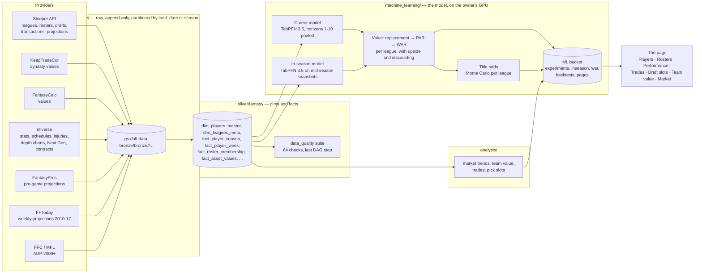
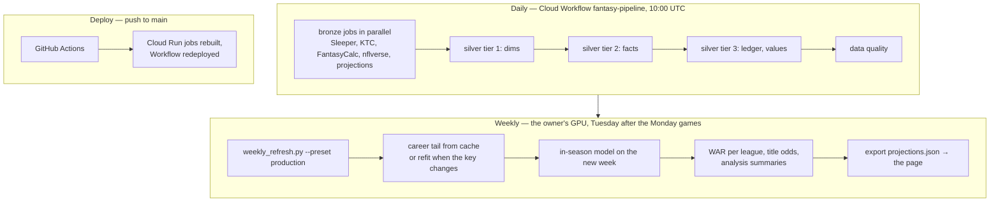
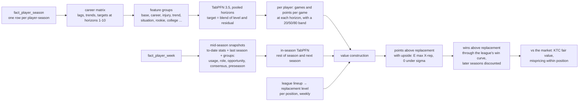

# Fantasy Analysis — how the whole thing fits together

A dynasty fantasy-football analytics system for the owner's Sleeper leagues. It ingests raw data from
several providers into a GCS data lake, models it into clean tables, trains a foundation-model
projection of every player's career, turns those projections into **wins** for each specific league,
and publishes a page the owner uses to price trades, picks and rosters. Everything runs on GCP on a
daily schedule, except the GPU model, which runs on the owner's PC weekly.

This file is the map. Each folder has its own `CLAUDE.md` with the local details; read those when you
work there. The running journal of what was tried and what won is
[machine_learning/BACKLOG.md](../machine_learning/BACKLOG.md).

## The system in one diagram



## How it runs



- **Daily:** one Cloud Scheduler trigger starts the Workflow in [orchestration/](../orchestration/);
  every pipeline is a Cloud Run job. Backfill (`*-full`, `*-yearly`) jobs run by hand.
- **Weekly:** the model needs a GPU, so [machine_learning/scripts/weekly_refresh.py](../machine_learning/scripts/weekly_refresh.py)
  runs on the owner's PC (RTX 5070 Ti). The career projections only change when a season completes,
  so they are cached per season; the weekly run is the in-season stage plus the exports.
- **Deploy:** push to `main` rebuilds the jobs. The owner merges every PR.

## The lake

```
gs://nfl-data-bronze/
  bronze/<source>/<entity>/<load_style>/load_date=<YYYY-MM-DD>/data.parquet   (or season=<Y>/)
  silver/fantasy/<dim_or_fact>/data.parquet
  silver/_quality/run_date=<d>/results.parquet                                 (the data-quality run)
gs://fantasy-football-ml/dynasty-value/
  experiments/ledger.parquet, experiments/runs/, experiments/cohorts/           (the harness)
  inseason/season=S/week=W/run_date=D/                                          (production projections)
  war/league=<slug>/season=S/week=W/run_date=D/                                 (per-league roster views)
  backtests/<kind>/run_date=D/summary.json                                      (analysis summaries)
  pages/season=S/week=W/run_date=D/projections.json                             (the page's payload)
```

Datasets are **DE's** (the lake); anything only the model needs is **ML's** (the ML bucket). Nothing
of either lives in local `data/`.

## The model, in one page

**Question answered:** how many wins does this player add to a roster in this league, this season and
in each of the next nine, and what is that worth against the market?



- **Career model** ([machine_learning/src/career.py](../machine_learning/src/career.py)): one TabPFN
  regressor for games and one for points per game over every horizon at once ("pooled"), the
  horizon as an input. TabPFN is in-context: there is no saved model, every prediction is a forward
  pass over the training rows, so predictions cost GPU time and the context is capped (~50k rows).
- **In-season model** ([machine_learning/src/inseason.py](../machine_learning/src/inseason.py)):
  the same idea on snapshots at checkpoint weeks, so the projection moves with the season. Feature
  groups are added one at a time through a funnel: a one-minute trees screen, then the GPU model.
- **Value** ([value.py](../machine_learning/src/value.py), [war.py](../machine_learning/src/war.py),
  [replacement.py](../machine_learning/src/replacement.py)): replacement is the best player left
  after every lineup fills, measured weekly so injuries push it deeper; a projection's upside is
  priced through its spread (sigma); points become wins on the league's own curve; seasons after
  this one are discounted (the page default 20 %).
- **Market** ([market.py](../machine_learning/src/market.py)): KTC dynasty superflex values, fair
  value by rank match, mispricing within position (the pooled number carries a quarterback lean).
- **Title odds** ([title.py](../machine_learning/src/title.py), [analysis/title_odds.py](../analysis/title_odds.py)):
  a Monte Carlo of the rest of the season per league, and of next season from projected lineups
  plus picks; each player's marginal title odds beside his WAR.

**How a change is accepted.** Every model change runs through the harness
([experiments.py](../machine_learning/src/experiments.py)): walk-forward cohorts 2015-2022, each
trained only on what was known then, scored on realized wins three seasons out. Two co-primary
metrics, the ordering of realized WAR among the top-150 projected and the wins error on them; a
candidate is adopted when it beats the same-day baseline past |t| = 2.4 on one with the other no
worse. Results live in the ledger; saved cohort frames can be rescored offline (positional scales,
sigma modes) without the GPU.

## The page

One HTML file (published as a private artifact) reading `projections.json`:
**Players** (WAR, PAR, bands, fair value, mispricing, season wind) · **Rosters** (each league's lineups,
marginal wins, title odds this season and next, trade targets, the trade finder) · **Model
performance** (backtests, the ledger) · **Trades** (the leagues' trading history, scored) · **Draft
slots** (expected slot of every pick) · **Team value** (KTC power rankings over time) · **Market**
(how the market itself prices: seasonality, momentum, age, picks, injuries).

## Repo map

| Path | What | Guide |
| --- | --- | --- |
| `data_engineering/` | bronze ingestion per source, silver modeling, the data-quality suite | [data_engineering/CLAUDE.md](../data_engineering/CLAUDE.md) and one per source folder |
| `machine_learning/` | the model, the harness, the weekly refresh, the exports | [machine_learning/CLAUDE.md](../machine_learning/CLAUDE.md), [README.md](../machine_learning/README.md), [BACKLOG.md](../machine_learning/BACKLOG.md) |
| `analysis/` | analysis scripts the page embeds + notebooks | [analysis/CLAUDE.md](../analysis/CLAUDE.md) |
| `orchestration/` | the daily Workflow DAG and its deploy | [orchestration/CLAUDE.md](../orchestration/CLAUDE.md) |
| `tests/` | the DE spec suite | [tests/README.md](../tests/README.md) |
| `.github/workflows/` | deploys on push to main | — |
| `alembic/` | a local relational mirror (secondary) | — |

## Glossary

- **Bronze / silver:** raw provider data as landed / modeled dims and facts (medallion layering).
- **Lineage:** a Sleeper league is a new league id every season; the lineage is the chain of ids that is one league over time. Franchises are keyed by lineage.
- **Ledger (roster membership):** who owned which player or pick on which day (SCD2 intervals), rebuilt from rosters, transactions and drafts.
- **Horizon h{k}:** the season k years after the row's season. h1 is next season off a complete-season row.
- **Cohort T:** the harness test year: models trained on seasons before T, projected for T's rows, scored on realized outcomes after T.
- **Snapshot:** a player's state at a checkpoint week of a season (to-date stats + last season), the in-season model's row.
- **Replacement level:** points per game of the best player available off the waiver wire at a position once every lineup in the league is filled, measured weekly.
- **PAR / WAR:** points above replacement / wins above replacement (PAR through the league's win curve, which maps points to win probability).
- **Sigma / band:** the spread of a projection; prices upside (a player at replacement is not worth zero). Per position from a holdout refit today; each player's own 20/80 band is under test.
- **KTC:** KeepTradeCut, the dynasty market; **fair value** = what the market would pay if it agreed with our value; **mispricing** = market minus fair, within position.
- **Blend target:** the career model predicts the mean of the level (next year's rate) and the residual (the change from this year's rate).
- **Funnel:** trees screen (one minute, CPU) → reduced 3.5 run → full paired run; features earn their place.
- **Co-primary rule:** ordering (`spearman_war_top`) and error (`mae_war_top`) decide together; see above.
- **TEP / SF:** tight-end premium scoring lens / superflex (two quarterbacks start), the owner's league format.
- **Title odds:** the chance of the playoffs, a bye, the title from a Monte Carlo of the remaining schedule; the lens next to WAR.

## Conventions that bite

- **Lake writes** happen only when the owner says so; backfills are run by hand.
- **Never two harness runs at once:** the ledger is read-modify-write.
- **A data bug is half fixed without a data-quality check** (`data_engineering/src/data_quality/`).
- **Long GPU runs are detached** (a `.cmd` wrapper + a one-shot Task Scheduler task), never a shell child.
- **The owner merges PRs**; check `gh pr view` before pushing to an old PR branch.
- **Tests:** root `.venv` for the DE suite, `machine_learning/.venv` for the ML suite; both green before a push.
